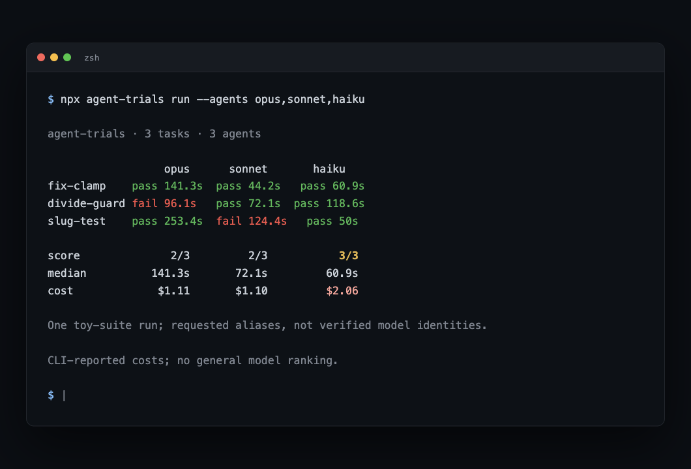

# agent-trials

Interview your coding agent before you ship with it.

`agent-trials` runs the same task suite through every coding agent CLI you have installed and prints a scoreboard: who passed, how long they took, what they spent. Each task gets a temporary working copy. Commands still run on your host.



## why

Public benchmarks score agents on tasks someone else picked. Your repo is not that benchmark. The question that matters before you let an agent loose on a codebase: does it fix YOUR bugs, in YOUR stack, at a sane price? Write the tasks once, run every candidate, keep the receipts.

## execution safety

A temporary working copy is not a security sandbox. Agents and suite commands run with your host permissions and environment; built-in Claude and Gemini commands disable approval prompts. Repository dotfiles and secrets may be copied. Use only trusted suites in a disposable VM with no sensitive files or credentials. Do not run this on a workstation containing private data.

## install

```sh
npx agent-trials init        # writes trials.json in your repo
```

Works straight from GitHub too: `npx github:princejain756/agent-trials`.

## use

```sh
agent-trials init           # starter suite
agent-trials doctor         # which agent CLIs are installed
agent-trials run            # run the suite, print the board, write TRIALS.md
```

## trials.json

```json
{
  "verify": "npm test",
  "verifyPaths": ["verify"],
  "timeoutSec": 600,
  "tasks": [
    {
      "id": "fix-cache",
      "prompt": "The cache in src/cache.js never expires entries. Add a ttl option. Keep the API.",
      "verify": "node checks/cache-ttl.mjs"
    }
  ],
  "agents": {
    "sonnet": { "run": ["claude", "-p", "{prompt}", "--dangerously-skip-permissions", "--model", "sonnet"] }
  }
}
```

Each cell (agent x task) works like this:

1. your repo, minus `node_modules` and `.git`, is copied to a temporary working copy
2. optional `setup` command runs once (`npm ci` and friends)
3. the agent runs headless on the task prompt, using the selected CLI flags, timeout-guarded
4. checker paths are restored from your repo, so the agent cannot rewrite its own test
5. your `verify` command runs in the working copy; exit 0 means pass

Step 4 restores `verifyPaths` from the suite, or a top-level `verify/` dir when `verifyPaths` is not set. A verify command that reads mutable state outside those paths can still be gamed; put your checkers in `verify/` or list them.

Builtin agents: `claude`, `codex`, `gemini`. Custom agents are one argv array away: anything installed, any flags, `{prompt}` gets replaced with the task prompt.

## a real run

`examples/tinylib` is a 3-function library with planted bugs. Same 3 tasks, 3 model variants of the same agent CLI (`claude --model`):

```
agent-trials · 3 tasks · 3 agents

                  opus      sonnet       haiku
fix-clamp    pass 141.3s  pass 44.2s   pass 60.9s
divide-guard  fail 96.1s  pass 72.1s  pass 118.6s
slug-test    pass 253.4s  fail 124.4s    pass 50s

score              2/3         2/3           3/3
median          141.3s       72.1s         60.9s
cost             $1.11       $1.10         $2.06

winner: haiku (3/3, median 60.9s)
```

Read this board with caveats. `opus`, `sonnet`, and `haiku` are requested CLI aliases; that run predates model-identity capture (`--json` now records `modelUsed` per cell when the agent CLI reports it). One run of three toy tasks is a smoke test, not a comparative benchmark. Costs are CLI-reported, not invoice costs.

What the board caught:

- haiku went 3/3 with the fastest median while spending the most: $2.06. Pass rate and price did not move together.
- in one earlier run, the agent asked a clarifying question ("should -0 count as zero?") into an empty terminal, then exited 0 having changed nothing. One observed example, not a general claim. This showed why exit code alone cannot be the verdict; the verify command is what counts.
- sonnet failed slug-test.

Full results with per-cell costs: [LEADERBOARD.md](LEADERBOARD.md)

## limits, honestly

- pass/fail is your verify command's exit code. The tool cannot judge taste, only outcomes.
- runs spend your agent quota and your auth; costs are reported when the agent's JSON output includes them (claude does)
- agent CLIs must be installed and logged in
- macOS/Linux; the working copy and verify assume `sh`. Windows untested
- scoring is binary per task. No partial credit for "almost fixed it"

## flags

| flag | default | what it does |
|---|---|---|
| `--suite <file>` | `trials.json` | suite file to run |
| `--agents a,b` | all known | restrict the agent list |
| `--root <dir>` | `.` | the repo being tested |
| `--jobs <n>` | `2` | parallel agent x task cells |
| `--out <file>` | `TRIALS.md` | markdown report path, `none` skips |
| `--json <file>` | - | raw per-cell results |
| `--keep` | off | keep working copies under /tmp for debugging |

## why the suite format is the point

Tasks are plain JSON and `verify` is plain shell, so a suite doubles as a smoke-test pack for humans. Commit `trials.json` next to the code it describes. When you swap agents or bump model versions, rerun and diff the board.

MIT
